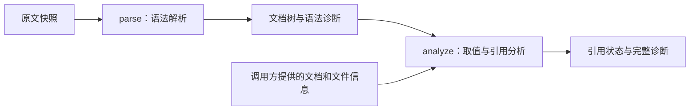

# org-lite 文档模型与解析接口 v0.1

本文将 [语法参考](reference.md) 落实为与编程语言、编辑器无关的数据契约。语法规则以语法参考为准；本文规定解析结果如何表示、原文位置如何记录、调用方如何取得诊断及引用结果。

状态：v0.1 数据结构及 parse／analyze 接口已实现。使用方式见 [README](../README.md)；[5 个契约样例](../examples/parse-contract.json) 的解析和分析结果均已通过验证。

TypeScript 实现提供文中接口；本文定义与实现语言无关的数据契约。

## 数据流与职责



核心边界如下：

- 一份不可变原文，加一棵带位置的文档树，构成一次解析结果。原文是保存内容的依据，树提供结构化访问。
- `parse` 只读输入文本；`analyze` 只读解析结果和显式上下文。两者均不访问磁盘、网络、环境变量或 Emacs，也不执行文档中的任何代码。
- 引用关系放在分析结果中，不把另一文档的节点嵌入当前文档树，避免树因链接变成循环图。
- 节点只表示已保留的语法和必要的原文回退区域；不为 TODO、日程、Babel 或未知 Org 扩展建立专用节点。

## 基础类型与位置

以下代码是类型伪代码，不是选定的实现语言。`T[]` 表示有序数组，`T | null` 表示可空，字符串使用 Unicode 标量值序列。表格列出的字段在该类型中均存在；空数组写 `[]`，空值写 `null`。

```text
Span = { start: Integer, end: Integer }
SourceId = String
NodeId = Integer

SourceSnapshot = {
  id: SourceId,
  text: String,
  origin: String | null
}

Location = { sourceId: SourceId, span: Span }
NodeLocation = { sourceId: SourceId, nodeId: NodeId, span: Span }
```

- 所有 Span 都是 UTF-8 **字节偏移**的左闭右开范围 `[start, end)`，不是字符数、UTF-16 单元数或显示列数。数字是 0～2^53−1 的整数，`start <= end`；超出可表示范围属于输入大小错误。
- Span 不得越过对应文本长度、切开 UTF-8 字符或切开 CRLF。允许空范围，例如空表格单元格和文件末尾位置。
- `source.text` 不改换行、不删除 BOM、零宽字符或尾随空白。BOM 若存在，按原文字符参与规则判断。原文的 UTF-8 编码是所有位置计算的依据。
- `SourceId` 是调用方给定的非空标识，区分大小写；它不表示文件路径，也不是标题的 `ID` 属性。一个分析上下文中，一个 SourceId 只能对应一个快照。
- `origin` 是调用方提供的文档绝对路径，或 `null`。解析器仅保存它；路径的绝对性、平台规则及文件目录关系由调用方负责。相对文件链接没有 origin 时保持待解析，不猜测工作目录。
- `NodeId` 在一个结果内唯一，由 0 开始，按后文规定的节点先序遍历连续分配。根节点为 0。重新解析后不得假设旧 NodeId 仍指向同一内容；跨结果引用必须同时携带 SourceId，并使用当前快照。

便于调用方定位的纯函数为：

```text
slice(source, span) -> Result<String, PositionError>
positionAt(source, byteOffset) -> Result<Position, PositionError>
offsetAt(source, position) -> Result<Integer, PositionError>

Position = { line: Integer, column: Integer }
PositionError = {
  code: "invalid-span" | "invalid-offset" | "invalid-position",
  message: String
}
```

line、column 均从 0 开始；column 按该行内 Unicode 标量值计数，不按字节、字素簇或显示宽度计数。制表符在此只占一个位置；语法缩进仍按 语法参考的 8 列规则计算。CRLF 是一个换行，不能定位在 CR 与 LF 中间。行尾换行之前的位置属于前一行末尾，换行之后属于下一行第 0 列；以换行结束的文件有末尾空行位置。有效位置与偏移必须能相互转换。

### 解释后的文字与原文对应

去缩进、链接转义和百分号解码会使解释后的文字不同于源文，使用同一种记录方式：

```text
MappedText = {
  text: String,
  pieces: MappingPiece[]
}

MappingPiece = {
  output: Span,
  source: Span,
  mode: "copy" | "replace"
}
```

- output 是相对于 `MappedText.text` 的 UTF-8 范围，source 是相对于所属 SourceSnapshot 的 UTF-8 范围。
- pieces 按 output 排列，必须无遗漏、无重叠地覆盖解释后文字；每片 output 和 source 均非空。空文字的 pieces 为 `[]`。
- source 各片按原文顺序排列且不重叠，位于所属节点的 Span 内；允许片与片之间有被去掉的缩进、逗号等空隙。
- `copy` 要求两边 UTF-8 内容完全相同；`replace` 表示一个源文范围对应不同的解释值，例如 `\[` 变成 `[`，或一个制表符剩余部分变成若干空格。连续 copy 片可以合并，片的分拆方式不影响等价性。
- 这种映射只服务于定位，不改写原文。删除的缩进无需生成零长度片；任何解释后字符都必须能追溯到一个非空源文范围。
- 名称比较得到的规范化键是索引值，不冒充原文，不需要单独保存 MappedText。实际名字仍保留在节点字段中。

## 文档树

### 公共约束

```text
Node = {
  id: NodeId,
  kind: String,
  span: Span,
  ...该 kind 的字段
}
```

`kind` 只能采用本文列出的值。语法不完整时使用 text、raw_inline 或 raw_block，不补造缺失的标题、块尾、属性或其他有效节点。

范围及遍历规则如下：

1. 根 Span 为 `[0, UTF8长度)`。子节点范围必须包含于父节点，兄弟节点按源文顺序且不重叠；空节点可以共享边界位置。父子节点可以有相同范围。
2. 节点范围不要求覆盖所有字符。标记间空白、容器缩进、空白行等可以位于节点间隙；完整原文始终由 SourceSnapshot 保存。不能靠拼接叶节点恢复文件。
3. 普通块从首个实际内容或标记开始，到最后内容行的换行之后结束；若没有该换行则到 EOF，不额外包含其后的空白行。列表第一行的段落从正文处开始，不包含列表标记和复选框。
4. heading 的范围从其标题行开始，到下一个同级或更高级标题之前，或 EOF，包含子树及中间空白；document 始终覆盖整个输入。列表、列表项的范围到最后一项内容结束，不占有结束列表的空白行。
5. 支持 NAME／CAPTION 的块带 `affiliations` 数组；其 Span 从第一条附属关键字开始。遍历先访问这些附属节点，再访问实际内容。没有附属关键字时为 `[]`。
6. delimiter、marker、标签位置等 Span 是字段，不是节点，不分配 NodeId。结构节点、行内节点、附属节点、属性、表格行与格、上下标部分均分配 NodeId。
7. 先序遍历先访问当前节点，再依下面各表列出的“节点子字段顺序”访问后代。其他字段、引用结果及诊断不参与树遍历。

### 根与标题

| kind | 专用字段 | 节点子字段顺序 |
| --- | --- | --- |
| `document` | `preamble: Block[]`，`headings: Heading[]` | preamble → headings |
| `heading` | `level: Integer`，`headlineSpan: Span`，`title: Inline[]`，`properties: PropertyDrawer 或 null`，`body: Block[]`，`headings: Heading[]` | title → properties → body → headings |

level 为原文星号数，至少为 1，不补造跳过的层级。headlineSpan 只覆盖标题行，包含其行尾换行；title 不含星号及其后的分隔空白。正文与子标题分开表示，对应 语法参考的标题树。

属性抽屉合法时进入 properties；非法抽屉回退成 body 中的原文节点，properties 为 null。属性绝不从父 heading 复制给子 heading。

### 正文、列表与原样区域

下表中的 `affiliations: Affiliation[]` 均为节点字段；`[]` 时仍保留该字段。

| kind | 专用字段 | 节点子字段顺序 |
| --- | --- | --- |
| `paragraph` | `affiliations`，`content: Inline[]` | affiliations → content |
| `horizontal_rule` | 无 | 无 |
| `list` | `affiliations`，`style: "unordered" 或 "ordered"`，`items: ListItem[]` | affiliations → items |
| `list_item` | `markerSpan: Span`，`ordinal: String 或 null`，`markerColumn: Integer`，`contentColumn: Integer`，`checkbox: Checkbox 或 null`，`body: Block[]` | body |
| `code_block` | `affiliations`，`language: String 或 null`，`openSpan: Span`，`bodySpan: Span`，`closeSpan: Span`，`value: MappedText` | affiliations |
| `example_block` | `affiliations`，`openSpan`，`bodySpan`，`closeSpan`，`value: MappedText` | affiliations |
| `quote_block` | `affiliations`，`openSpan`，`bodySpan`，`closeSpan`，`body: Block[]` | affiliations → body |
| `comment` | `form: "line" 或 "block"`，`bodySpan: Span` | 无 |
| `raw_block` | `form: "line" 或 "region"` | 无 |

```text
Checkbox = { span: Span, state: "unchecked" | "checked" | "partial" }
```

- ordinal 仅在有序项中存在为非空数字字符串，保留前导零及全部位数；无序项为 null。不把它转成可能溢出的整数。所属 list.style 与每项必须一致。
- markerSpan 包含项目标记及其后分隔水平空白，不含复选框。markerColumn、contentColumn 为原文物理行的 B、C 列，均从 0 起，使用 8 列制表符；嵌套时也记录物理列，不改成相对父项的列。
- 代码和示例的 value 按语法规范完成去缩进及逗号解码，内部没有 Org 子节点；保留内容原有 LF／CRLF。代码 language 不决定执行或高亮能力。
- 对上述代码、示例和引用块，openSpan 从开始关键字到该行换行之后；closeSpan 从结束关键字到该行换行之后；bodySpan 是两行之间的原始范围，不含结束行的缩进。没有换行时相应范围到 EOF。三个范围均在整个节点范围内，允许因缩进存在间隙。LaTeX 的定界范围另按下文规则记录。
- comment 的 form=block 时 bodySpan 是块头、块尾之间的原文；form=line 时是 `#` 及其分隔空白之后到行尾之前的原文。注释不递归解析，不建立引用定义。
- raw_block 是独立文字行或语法回退保留下来的整个区域，不递归解析。未知块只把定界行记为 raw_block；带排除参数但完整闭合的已知块按 E2 整段记为一个 raw_block。
- 未闭合块没有 code_block、quote_block 等半成品节点；开始行回退，其后按语法规则正常建树。

### 表格

| kind | 专用字段 | 节点子字段顺序 |
| --- | --- | --- |
| `table` | `affiliations`，`columnCount: Integer`，`rows: TableRow[]` | affiliations → rows |
| `table_row` | `role: "data" 或 "format"`，`cells: TableCell[]` | cells |
| `table_separator` | 无 | 无 |
| `table_cell` | `content: Inline[]`，`format: ColumnFormat 或 null` | content |

```text
ColumnFormat = {
  alignment: "left" | "center" | "right" | null,
  width: String | null
}
```

rows 可混合 table_row 和 table_separator，保留原顺序；分隔行没有单元格。columnCount 取实际普通行的最大格数，只有分隔行的表格为 0 列。不为缺失格补造 table_cell；调用方按行长度和 columnCount 得到缺失空格。

单元格 span 为两个分隔竖线之间或最后竖线到行尾之间的实际范围，不含分隔符与行尾换行，允许为空。普通格 content 按去掉排版空白后的内容解析；格式格 content 为 `[]`，format 记录声明。width 为语法规定的正十进制数字字符串，避免任意长度数值溢出。

role=format 只在该行满足语法的纯格式行条件时成立。列的有效对齐、宽度从各实际格式格按原顺序计算，重复冲突由 analyze 诊断；不在树中再存一份可能与原格不一致的有效列配置。

### 元数据、属性和脚注

| kind | 专用字段 | 节点子字段顺序 |
| --- | --- | --- |
| `document_title` | `value: Inline[]` | value |
| `property_drawer` | `openSpan: Span`，`closeSpan: Span`，`entries: Property[]` | entries |
| `property` | `key: String`，`keySpan: Span`，`value: MappedText` | 无 |
| `name` | `value: MappedText` | 无 |
| `caption` | `value: Inline[]` | value |
| `footnote_definition` | `label: String`，`labelSpan: Span`，`body: Block[]` | body |

Affiliation 只允许 name 或 caption。它们只出现在所属块的 affiliations 中；不能附着时成为独立 raw_block，并给出 orphan 诊断。

property.key 是 ASCII 大写键，keySpan 指向原始键文字、不含冒号；其 value 只去掉首尾水平空白，不解释行内标记。所有重复字段和定义都保留为节点，有效值由首值规则推导，不覆盖或删除树中的后值。非法 ID 值仍保留在 property 中，只是不进入定义索引。

document_title 仅表示合法位置的 TITLE；正文中的 TITLE 是 raw_block。文档的有效标题是 preamble 中第一个 document_title。脚注定义保留原有标签，不生成显示编号。

### 行内节点

| kind | 专用字段 | 节点子字段顺序 |
| --- | --- | --- |
| `text` | `value: MappedText` | 无 |
| `soft_break` | 无 | 无 |
| `emphasis` | `style: "bold"、"italic"、"underline" 或 "strike"`，`openSpan: Span`，`closeSpan: Span`，`content: Inline[]` | content |
| `inline_code` | `openSpan`，`bodySpan`，`closeSpan`，`value: MappedText` | 无 |
| `verbatim` | `openSpan`，`bodySpan`，`closeSpan`，`value: MappedText` | 无 |
| `entity` | `name: String`，`nameSpan: Span`，`terminated: Boolean` | 无 |
| `link` | `targetSpan: Span`，`target: LinkTarget`，`description: Inline[] 或 null`，`imageCandidate: Boolean` | description |
| `target` | `name: MappedText` | 无 |
| `footnote_reference` | `label: String`，`labelSpan: Span` | 无 |
| `raw_inline` | 无 | 无 |

- soft_break 只表示同一段落内部的原有换行，其 span 精确覆盖 LF 或 CRLF。段落最后一个行尾换行留在段落 span 中，不额外产生末尾 soft_break；不存在强制换行节点。
- text 不包含换行；连续文字在没有其他节点、解码模式或原文间隙打断时合并。内容值是语法解释后的文字，不做显示层的空白折叠。
- entity 保留名字，不在解析阶段替换成显示字符；terminated 表示是否带 `{}`。实体符号词典仍由 syntax.md 规定。
- link.description=null 表示没有显示文字部分，`[]` 表示显式的空显示文字。imageCandidate 严格由语法的后缀、描述和定位条件计算，不建立另一种与链接重复的图片节点。
- raw_inline 表示须整体作为原文的候选，例如不支持协议的完整链接。它没有格式或引用子节点；不需要再复制一份 raw 字符串，直接取其 span。
- 行内节点是否允许出现在标题、链接显示文字、题注等位置，按 语法参考的上下文表校验，不能因数据类型同属 Inline 就放宽规则。

### 上下标

```text
scripted: Node + { base: Inline, parts: ScriptPart[] }

script_part: Node + {
  position: "sub" | "super",
  form: "bare" | "brace" | "paren" | "star",
  content: Inline[]
}
```

scripted 的子节点顺序为 base → parts；script_part 的子节点为 content。parts 至少有一项，script_part.span 从 `_` 或 `^` 开始，包含相应括号。base 不得为空，不直接是 script_part。

若基础内容是前一个 text 的末尾字符，按最后一个 Unicode 标量值拆出 text 节点；若基础内容是完整的其他行内节点，则作为 base 整体保留。连续上下标追加到同一个 scripted.parts，不把前一个脚本内容当成新基础。

例如 `x_{i}^{2}` 表示为：

```text
scripted
  base: text("x")
  parts:
    script_part(position="sub", form="brace", content=[text("i")])
    script_part(position="super", form="brace", content=[text("2")])
```

`x^{y^{z}}` 的上标内容内另含 scripted，范围始终正确嵌套。

### LaTeX 原文

```text
latex: Node + {
  affiliations: Affiliation[],
  placement: "inline" | "block",
  form: "paren" | "dollar" | "bracket" | "double_dollar" |
        "environment" | "command",
  name: String | null,
  openSpan: Span | null,
  bodySpan: Span,
  closeSpan: Span | null,
  value: MappedText
}
```

节点子字段只有 affiliations。环境和命令内部不生成 Org 节点。

- environment 只能是 block，name 为环境名；command 只能是 inline，name 为命令名。其他 form 的 name 为 null。
- paren、dollar 只能是 inline；bracket、double_dollar 可位于 inline 或 block，遵守语法的行位置规则。
- command 的 openSpan、closeSpan 均为 null，bodySpan 覆盖完整命令及参数，value 保存它的原文值；其他 form 的 openSpan、closeSpan 均非空，bodySpan 和 value 只表示定界符之间的内容。
- LaTeX 的 openSpan、closeSpan 仅覆盖实际定界符，不自动包含整行或换行；环境则分别覆盖 `\begin{ENV}` 与对应 `\end{ENV}`。因此开始行上紧随 begin 的内容仍属于 bodySpan，不会丢失。block 节点的整个 span 仍包含结束行的尾随空白与换行。
- inline 的 affiliations 必须为 `[]`；block 形式可以附着 NAME／CAPTION。有效环境嵌套仍作为一段 LaTeX 原文保存，不为内部每个环境建树。
- 所有值只做所属容器要求的去缩进，不执行 TeX，不把内部字符再当 Org 格式。

### 允许的块集合

Block 包含 paragraph、horizontal_rule、list、code_block、example_block、quote_block、comment、raw_block、table、footnote_definition、document_title，以及 placement=block 的 latex。list_item、table_row、property 等只能出现在相应专用字段，不能作为任意 Block。

根 preamble 可包含全部合法 Block；heading.body 排除 document_title。列表项和引用的 body 排除 document_title、footnote_definition；脚注正文的 body 也排除这两者。TITLE、属性抽屉及脚注定义仍须满足语法规定的位置，不因模型允许某字段就自动有效。

## 链接目标与引用结果

### LinkTarget

```text
LinkTarget =
  { kind: "web", address: MappedText }
  | { kind: "file", path: MappedText,
      pathValid: Boolean, selector: FileSelector | null }
  | { kind: "id", value: MappedText }
  | { kind: "custom_id", value: MappedText }
  | { kind: "heading", value: MappedText }
  | { kind: "local_name", value: MappedText }

FileSelector =
  { kind: "line", value: MappedText }
  | { kind: "heading", value: MappedText }
  | { kind: "custom_id", value: MappedText }
  | { kind: "regexp", value: MappedText }
  | { kind: "text", value: MappedText }
  | { kind: "invalid", value: MappedText }
```

字段值均去掉各自固定前缀：file.path 不含 `file:`；id.value 不含 `id:`；heading.value 不含 `*`；custom_id.value 不含 `#`；正则 value 不含外层 `/`。web.address 保留协议。所有原始形式仍可从 link.targetSpan 得到。

行号 value 保留数字字符串；转换成具体位置时再检查范围。invalid 保留不能成立的定位内容；pathValid=false 表示路径百分号解码失败，path 保留未解码原文值，不能据此猜文件。二者仍属于合法 link 外壳，与回退成 raw_inline 的未知协议或空目标不同。

LinkTarget 没有未知协议变体。未成功构成有效链接外壳的内容不产生 link，依语法回退为文字。

### 分析结果

```text
AnalysisResult = {
  sourceId: SourceId,
  references: ReferenceResolution[],
  diagnostics: Diagnostic[]
}

ReferenceResolution = {
  nodeId: NodeId,
  status: "resolved" | "pending" | "unresolved" | "ambiguous" | "invalid",
  targets: Destination[],
  reason: String | null
}

Destination =
  { kind: "node", sourceId: SourceId, nodeId: NodeId, span: Span }
  | { kind: "range", sourceId: SourceId, span: Span }
  | { kind: "resource", key: String }
  | { kind: "web", address: String }
```

每个 link 和 footnote_reference 恰有一个 ReferenceResolution，按引用节点的源文顺序排列；target 和定义节点不产生引用记录。nodeId 属于本次被分析的主文档。

| status | 含义 | targets |
| --- | --- | --- |
| resolved | 已知目标成立，或网页地址已按语法确定 | 恰好一个 |
| pending | 基准路径、外部资源内容或完整 ID 范围尚未提供 | 空 |
| unresolved | 在已知且完整的查找范围中没有目标 | 空 |
| ambiguous | 最先匹配的目标类别中有多个候选 | 至少两个 |
| invalid | 路径编码、定位值或目标资源类型不能满足该链接 | 空 |

web 的 resolved 只表示地址成立，不表示网络可达。内部引用返回 node；文件行号返回行首的空 range，文本和正则返回实际匹配 range；没有文件内定位的文件链接返回 resource。脚注重复定义遵循首值规则，返回首个定义，不变成 ambiguous。

reason 在 resolved 时为 null；其余状态为面向调用方的原因文字，不作为稳定的机器枚举。需要稳定判断时使用 status 及诊断 code。候选 Destination 按 SourceId 的 UTF-8 字节序、span.start、span.end、NodeId 排序；resource、web 不参与歧义候选排序。

## 诊断

```text
Diagnostic = {
  code: "unsupported" | "malformed" | "unclosed" | "orphan" |
        "invalid-value" | "duplicate" | "unresolved" | "ambiguous",
  phase: "parse" | "analyze",
  location: Location,
  message: String,
  related: RelatedLocation[]
}

RelatedLocation = { location: Location, message: String }
```

code 沿用语法规范；message 供人阅读，可本地化，不用于程序分支。诊断位置只覆盖有问题的实际候选，不指向人为补造的字符。重复字段定位到后一次定义，并通过 related 指向首值；歧义引用定位到引用，通过 related 列出候选位置。

职责划分如下：

| parse 负责 | analyze 负责 |
| --- | --- |
| 不闭合的块、公式和链接等 | 字段、脚注及命名目标的重复 |
| 不支持的完整候选、非法块头参数 | ID／CUSTOM_ID／NAME 的取值合法性及注册 |
| 已闭合但结构不合法的抽屉 | 表格格式声明冲突 |
| 孤立结束行及无法附着的 NAME／CAPTION | 引用未找到或存在歧义 |
| 需要整体回退的非法链接目标，以及保留文件链接中的编码、定位语法错误 | 文件行号超界、资源类型与定位不相容 |

重复字段、冲突和非法取值不会改动树。没有明确诊断要求的普通短标记按语法处理，不额外将正常文字标成错误。pending 不生成 unresolved 诊断。

`analyze.diagnostics` 是主文档的完整诊断：保留原 parse 诊断，再加入本轮分析诊断，不让调用方自行拼接。再次 analyze 时从原 ParseResult 重新计算，不叠加旧分析结果。外部文档自己的 parse 诊断由其 ParseResult 持有；相关位置可跨文档，但不把外部文档全部错误复制到主文档。

诊断按 `(location.sourceId 的 UTF-8 字节序, start, end, code, phase)` 稳定排序；related 按位置排序。相同 code、phase、主位置及相关位置集合的诊断只保留一条。诊断措辞和 MappingPiece 的合法分拆方式不属于快照比较的固定内容。

## 解析接口

### parse

```text
parse(input: SourceSnapshot) -> Result<ParseResult, InputError>

ParseResult = {
  modelVersion: "0.1",
  syntaxVersion: "0.1",
  source: SourceSnapshot,
  document: Document,
  diagnostics: Diagnostic[]
}

InputError = {
  code: "invalid-source-id" | "invalid-unicode" | "input-too-large",
  message: String
}
```

parse 的行为契约：

1. 接受有效 Unicode 原文，包括空输入；空输入返回 span=[0,0) 且两个数组为空的 document。
2. 普通语法错误一律返回成功的 ParseResult 和诊断，不使用 InputError。宿主字符串中存在未配对代理项等非 Unicode 标量值时返回 invalid-unicode，不静默替换。
3. 返回结果为独立不可变快照，不共享调用方可变的文本缓冲区。相同输入产生等价树、字段和诊断；不得读取时钟、用户配置或工作目录来改变解释。
4. 同一次调用完成整份文档解析。结果没有“部分实现但成功”的节点和特性开关；尚未实现全规范的开发原型必须明确标为不完整，不能声称通过 v0.1 契约。
5. 此接口不接受只解析一段行内文字的公开模式，因为行内含义依赖所在上下文。内部可以分层实现，但对外先保留一个整文档入口。

从文件字节读取时可使用等价的解码入口：

```text
parseUtf8(id, bytes, origin) -> Result<ParseResult, InputError | DecodeError>
DecodeError = { code: "invalid-utf8", byteSpan: Span, message: String }
```

它严格解码 UTF-8 后调用同一解析流程，BOM 保留；DecodeError 的 byteSpan 指向原始字节中第一个非法编码序列。此时尚未产生有效的 SourceSnapshot，因此该范围只按原始字节计数，不适用有效 Unicode 字符边界的约束。不自行打开路径。内存耗尽、取消或实现缺陷不伪装成语法诊断，也不返回看似完整的成功结果；具体语言中的运行时失败表达方式由实现选择。

### analyze

```text
analyze(parsed: ParseResult, context?: ResolutionContext)
  -> Result<AnalysisResult, ContextError>

ResolutionContext = {
  documents: ParseResult[],
  idScopeComplete: Boolean,
  files: FileBinding[]
}

FileBinding = {
  from: SourceId,
  path: String,
  result: { state: "missing" }
        | { state: "available", resource: Resource }
}

Resource =
  { key: String, kind: "document", parsed: ParseResult }
  | { key: String, kind: "text", source: SourceSnapshot }
  | { key: String, kind: "opaque" }

ContextError = {
  code: "duplicate-source" | "duplicate-file-binding" |
        "inconsistent-resource" | "version-mismatch",
  message: String
}
```

空上下文为 `{documents: [], idScopeComplete: false, files: []}`；主文档总会自动加入当前分析范围，不要求调用方重复传入。

- documents 和文件绑定中的 document 资源共同构成已知文档集合。相同 SourceId 的同一快照可被引用多次并去重；不同原文、origin 或解析结果不得用同一 SourceId，违反时返回 duplicate-source。
- ID 范围包含主文档和上述集合。有多个匹配为 ambiguous，恰有一个为 resolved；没有匹配且 idScopeComplete=true 时为 unresolved，否则为 pending。resolved 只针对本轮提供的候选集合；以后加入另一份同 ID 文档时必须重新分析，结果可以变为 ambiguous。
- 文件绑定按 `(from, path)` 精确匹配。path 是链接解码后的路径字符串；from 说明该路径出现在哪份文档，避免同名相对路径跨目录混淆。路径基准、`~/` 展开、平台路径规范化和实际读取均由调用方在构造绑定之前处理，核心不猜测。
- 同一文件绑定键只能出现一次。没有该绑定表示信息未提供，得到 pending；state=missing 表示调用方确认不存在，得到 unresolved；不能因目录尚未加载就返回 missing。
- Resource.key 为调用方给定的非空资源标识，同 key 的资源必须一致。document 可进行标题、锚点等结构定位和文字定位；text 仅提供行号、全文或正则搜索；opaque 仅证明资源存在，没有可搜索文本。
- 普通文件链接只需知道资源存在即可 resolved。定位所需文本或文档结构未提供时为 pending；调用方明确提供为纯 text，却请求标题或 CUSTOM_ID 等文档结构定位时为 invalid。opaque 不自动判定“不可能有文本”，保持待提供内容。
- 纯文本资源上的 `text` 定位直接进行精确字串搜索；文档资源先依语法查找锚点、NAME、标题，再进行字串搜索。正则按 语法参考的固定子集执行，不透传所用库的额外语法。
- 网页链接不查 files。相对文件链接缺失 origin 时，即使存在同名绑定也不默认建立基准，保持 pending；绝对路径或 `~/` 的显式绑定可以使用。
- analyze 验证输入版本及上下文一致性。ContextError 只表示调用参数互相矛盾；目标缺失、文档有错、链接歧义等仍是正常的 AnalysisResult。
- analyze 不修改 parsed，不加载依赖文档，不递归展开脚注或追踪链接访问整个世界。新增文档或改变文件可用信息后，调用方可用同一 ParseResult 和新上下文重新分析。

## 数据契约示例

原文：

```org
* 项目
- [ ] 写文档
```

结构为：

```text
document #0
  heading #1(level=1)
    title: text #2("项目")
    body:
      list #3(style="unordered")
        list_item #4(checkbox="unchecked")
          paragraph #5
            text #6("写文档")
```

假设这两行都以 LF 结束，源文 UTF-8 长度为 25 字节：标题文字位于 `[2,8)`，复选框位于 `[11,14)`，列表正文位于 `[15,24)`。这些位置体现了汉字不能按单字节处理。完整 JSON 见 [parse-contract.json](../examples/parse-contract.json)。

该文件另含本地锚点引用、未闭合代码块、带 CRLF 的制表符续行和带转义括号的文件链接，检验引用与树分离、错误恢复、替换映射及 pending 状态。这些样例作为解析和分析结果的契约。

## 验收不变量

实现应满足以下不变量：

1. SourceSnapshot 与输入逐字一致；从它取得原文不丢任何字符，空白输入和纯未知语法也成立。
2. 所有节点、字段位置、诊断及映射均在正确快照范围内，不切开 Unicode 字符或 CRLF；树节点 ID 和遍历顺序一致。
3. MappedText 每个输出字符都有原文来源，copy 片内容相等，制表符部分去缩进、链接解码和逗号转义都可定位。
4. 每个保留语法都有对应节点或明确的字段表示，每个被排除的语法都按回退规则处理，不出现半成品有效节点。
5. 同上下文重复 analyze 不累积诊断；增加已知文档可以改变引用状态，但不改变 ParseResult 的树或原文。
6. 未加载与确认缺失、重复字段首值与重复目标歧义、合法链接与失败候选回退必须分别处理。

实现可使用 [52 个语法规范示例](examples.md)和[契约样例](../examples/parse-contract.json)验收。增量解析、持久 NodeId、编辑事务、全局索引服务和渲染器不属于当前契约。
