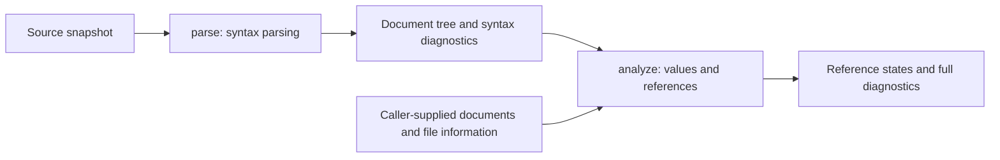

# org-lite Document Model and Parser API v0.1

This document turns the [syntax reference](reference.md) into a language- and editor-independent data contract. The reference defines syntax; this document defines result representation, source positions, diagnostics, and reference results.

The v0.1 data structures and parse/analyze interfaces are implemented. See the [README](../README.md) for usage and the [five contract examples](../examples/parse-contract.json) for verified parse and analysis results.

The TypeScript implementation provides these interfaces; the contract itself is language-independent.

## Data flow and responsibilities



Core boundaries:

- A parse result consists of an immutable source snapshot and a document tree with positions. The source is authoritative for saved content; the tree supplies structured access.
- `parse` reads only the input; `analyze` reads only the parse result and explicit context. Neither accesses disk, network, environment variables, or Emacs, or executes document code.
- Reference relationships belong to the analysis result. Nodes from another document are not embedded into the tree, preventing reference cycles in the tree.
- Nodes represent supported syntax and required raw fallback regions; there are no dedicated nodes for TODO, scheduling, Babel, or unknown Org extensions.

## Basic types and positions

The following is type pseudocode, not a specific programming language. `T[]` is an ordered array, `T | null` is nullable, and strings are Unicode scalar sequences. Fields listed for a type are always present; empty arrays are `[]` and null values are `null`.

```text
Span = { start: Integer, end: Integer }
SourceId = String
NodeId = Integer

SourceSnapshot = {
  id: SourceId,
  text: String,
  origin: String | null
}

Location = { sourceId: SourceId, span: Span }
NodeLocation = { sourceId: SourceId, nodeId: NodeId, span: Span }
```

- Every Span is a half-open `[start, end)` range of UTF-8 **byte offsets**, not characters, UTF-16 units, or display columns. Offsets are integers from 0 through 2^53−1, with `start <= end`; exceeding the range is an input-size error.
- A Span cannot exceed the source or split a UTF-8 character or CRLF. Empty spans are allowed, for example for empty cells and EOF.
- `source.text` preserves line endings, BOM, zero-width characters, and trailing whitespace. A BOM participates in syntax as a source character. Positions are based on the UTF-8 encoding of the source.
- `SourceId` is a nonempty, case-sensitive caller-supplied identifier. It is neither a file path nor a heading `ID`; one analysis context cannot use it for different snapshots.
- `origin` is a caller-supplied absolute document path or `null`. The parser stores it; the caller handles path and platform rules. A relative file link without an origin remains pending rather than assuming the working directory.
- `NodeId` is unique within a result, assigned consecutively from 0 in the preorder defined below; the root is 0. IDs are not persistent across reparses. Cross-result references must include SourceId and use the current snapshot.

Pure position helpers:

```text
slice(source, span) -> Result<String, PositionError>
positionAt(source, byteOffset) -> Result<Position, PositionError>
offsetAt(source, position) -> Result<Integer, PositionError>

Position = { line: Integer, column: Integer }
PositionError = {
  code: "invalid-span" | "invalid-offset" | "invalid-position",
  message: String
}
```

Both line and column are zero-based. Column counts Unicode scalar values on the line, not bytes, grapheme clusters, or display columns; a tab counts as one position. Syntax indentation separately uses eight-column tab stops. CRLF is one newline and cannot be split by a position. The position before a newline is at the end of the preceding line; after it is column 0 of the next line. A trailing newline creates a final empty-line position. Valid positions and byte offsets round-trip.

### Mapping interpreted text to source

Dedenting, link escapes, and percent decoding can change interpreted text. All use the same representation:

```text
MappedText = {
  text: String,
  pieces: MappingPiece[]
}

MappingPiece = {
  output: Span,
  source: Span,
  mode: "copy" | "replace"
}
```

- `output` is a UTF-8 range in `MappedText.text`; `source` is a UTF-8 range in the enclosing SourceSnapshot.
- Pieces are ordered by output and cover the interpreted text without gaps or overlaps. Each output and source range is nonempty; empty text has `[]` pieces.
- Source ranges are ordered, nonoverlapping, and inside the node span. Gaps may represent removed indentation or commas.
- `copy` requires identical UTF-8 content on both sides. `replace` maps a source range to a different value, such as `\[` to `[` or a partially removed tab to spaces. Adjacent copy pieces may be merged; legal partitioning does not affect equivalence.
- Mappings support location, not source rewriting. Removed indentation needs no empty piece; every interpreted character must trace to a nonempty source range.
- Normalized name-comparison keys are index values, not source text, and require no separate MappedText. Actual names remain in node fields.

## Document tree

### Common constraints

```text
Node = {
  id: NodeId,
  kind: String,
  span: Span,
  ...fields for this kind
}
```

`kind` is one of the values listed below. Incomplete syntax uses text, raw_inline, or raw_block; missing headings, closers, properties, or other valid nodes are not invented.

Span and traversal rules:

1. The root span is `[0, UTF8_length)`. Children are within their parent; siblings are in source order and do not overlap. Empty nodes may share boundaries; parent and child spans may coincide.
2. Node spans need not cover every character. Whitespace, container indentation, and blank lines may lie in gaps; SourceSnapshot preserves the complete source. Concatenating leaf nodes cannot reconstruct the file.
3. An ordinary block begins at its first actual content or marker and ends after the final content line newline, or at EOF if absent; it does not include later blank lines. The first paragraph of a list item starts at its body, excluding marker and checkbox.
4. A heading span starts at its heading line and ends before the next heading of equal or higher level, or EOF, including descendants and intermediate whitespace. The document spans the whole input. Lists and items end with their last content, not the blank lines that close the list.
5. Blocks supporting NAME/CAPTION have an `affiliations` array and their span starts at the first affiliated keyword. Visit affiliations before content; the array is `[]` when absent.
6. Delimiter, marker, and label spans are fields, not nodes, and have no NodeId. Structural, inline, affiliation, property, table row/cell, and script-part nodes have IDs.
7. Preorder visits the current node before children in the order listed below. Other fields, reference results, and diagnostics are not tree children.

### Root and headings

| kind | Fields | Child traversal order |
| --- | --- | --- |
| `document` | `preamble: Block[]`, `headings: Heading[]` | preamble → headings |
| `heading` | `level: Integer`, `headlineSpan: Span`, `title: Inline[]`, `properties: PropertyDrawer or null`, `body: Block[]`, `headings: Heading[]` | title → properties → body → headings |

`level` is the number of source asterisks, at least 1; skipped levels are not invented. `headlineSpan` covers only the heading line including its newline; `title` excludes the markers and following separator. Body and child headings are separate.

A valid drawer is in `properties`; an invalid drawer becomes a raw body node and `properties` is null. Properties are never copied from a parent heading.

### Body, lists, and literal regions

The `affiliations: Affiliation[]` fields below remain present even when empty.

| kind | Fields | Child traversal order |
| --- | --- | --- |
| `paragraph` | `affiliations`, `content: Inline[]` | affiliations → content |
| `horizontal_rule` | None | None |
| `list` | `affiliations`, `style: "unordered" or "ordered"`, `items: ListItem[]` | affiliations → items |
| `list_item` | `markerSpan: Span`, `ordinal: String or null`, `markerColumn: Integer`, `contentColumn: Integer`, `checkbox: Checkbox or null`, `body: Block[]` | body |
| `code_block` | `affiliations`, `language: String or null`, `openSpan: Span`, `bodySpan: Span`, `closeSpan: Span`, `value: MappedText` | affiliations |
| `example_block` | `affiliations`, `openSpan`, `bodySpan`, `closeSpan`, `value: MappedText` | affiliations |
| `quote_block` | `affiliations`, `openSpan`, `bodySpan`, `closeSpan`, `body: Block[]` | affiliations → body |
| `comment` | `form: "line" or "block"`, `bodySpan: Span` | None |
| `raw_block` | `form: "line" or "region"` | None |

```text
Checkbox = { span: Span, state: "unchecked" | "checked" | "partial" }
```

- `ordinal` is a nonempty digit string only for ordered items, preserving leading zeroes and all digits; it is null for unordered items. It is not converted to a possibly overflowing integer. The parent list style and items agree.
- `markerSpan` covers the marker and following separator whitespace, not the checkbox. `markerColumn` and `contentColumn` are zero-based physical B and C columns with eight-column tabs, including for nested items.
- Code and example values are dedented and comma-decoded under the syntax rules, contain no Org child nodes, and preserve original LF/CRLF. The language does not imply execution or highlighting.
- For source, example, and quote blocks, `openSpan` and `closeSpan` extend from each delimiter through its line ending; `bodySpan` covers source between those lines, excluding the closer indentation. Without a final newline, the range ends at EOF. All are within the node; indentation can leave gaps. LaTeX delimiters use the rules below.
- For block comments, `bodySpan` covers text between opener and closer; for line comments it covers text after `#` and its separator, excluding the newline. Comments have no parsed children or reference definitions.
- `raw_block` is a separate raw line or a whole fallback region and is not recursively parsed. Unknown block delimiters alone are raw lines; a closed known block with excluded parameters is one raw region under E2.
- Unclosed blocks have no incomplete code_block or quote_block nodes; the opener falls back and later text is parsed normally.

### Tables

| kind | Fields | Child traversal order |
| --- | --- | --- |
| `table` | `affiliations`, `columnCount: Integer`, `rows: TableRow[]` | affiliations → rows |
| `table_row` | `role: "data" or "format"`, `cells: TableCell[]` | cells |
| `table_separator` | None | None |
| `table_cell` | `content: Inline[]`, `format: ColumnFormat or null` | content |

```text
ColumnFormat = {
  alignment: "left" | "center" | "right" | null,
  width: String | null
}
```

`rows` mixes table_row and table_separator in source order; separators have no cells. `columnCount` is the maximum actual ordinary-row cell count, or 0 for a separator-only table. Missing cells are not invented; callers infer them from row length and columnCount.

A cell span covers actual text between delimiters or from the last delimiter to line end, excluding pipes and newline; it may be empty. Ordinary content is parsed after trimming layout whitespace. A format cell has `content: []` and its declaration in `format`. Width is a positive decimal string to avoid overflow.

`role=format` requires a pure format row. Effective alignment and width are computed in source order from format cells; analyze diagnoses conflicts. The tree does not duplicate an effective configuration that might disagree with its cells.

### Metadata, properties, and footnotes

| kind | Fields | Child traversal order |
| --- | --- | --- |
| `document_title` | `value: Inline[]` | value |
| `property_drawer` | `openSpan: Span`, `closeSpan: Span`, `entries: Property[]` | entries |
| `property` | `key: String`, `keySpan: Span`, `value: MappedText` | None |
| `name` | `value: MappedText` | None |
| `caption` | `value: Inline[]` | value |
| `footnote_definition` | `label: String`, `labelSpan: Span`, `body: Block[]` | body |

Affiliation is restricted to name or caption and appears only in its block’s affiliations. Unattached declarations become raw_block with an orphan diagnostic.

`property.key` is ASCII uppercase; `keySpan` covers the original key without colons. Values have only edge horizontal whitespace removed and do not parse inline syntax. Duplicate fields and definitions remain nodes; first-value rules determine effective values without removing later ones. Invalid IDs remain properties but do not enter the definition index.

`document_title` represents TITLE only in a valid position; TITLE in body content is raw_block. The first document_title in preamble is effective. Footnote labels are preserved without generating display numbers.

### Inline nodes

| kind | Fields | Child traversal order |
| --- | --- | --- |
| `text` | `value: MappedText` | None |
| `soft_break` | None | None |
| `emphasis` | `style: "bold", "italic", "underline" or "strike"`, `openSpan: Span`, `closeSpan: Span`, `content: Inline[]` | content |
| `inline_code` | `openSpan`, `bodySpan`, `closeSpan`, `value: MappedText` | None |
| `verbatim` | `openSpan`, `bodySpan`, `closeSpan`, `value: MappedText` | None |
| `entity` | `name: String`, `nameSpan: Span`, `terminated: Boolean` | None |
| `link` | `targetSpan: Span`, `target: LinkTarget`, `description: Inline[] or null`, `imageCandidate: Boolean` | description |
| `target` | `name: MappedText` | None |
| `footnote_reference` | `label: String`, `labelSpan: Span` | None |
| `raw_inline` | None | None |

- `soft_break` represents an original LF or CRLF inside a paragraph and its span covers precisely that newline. A paragraph’s final newline is included in its span but does not create an extra soft_break. There is no hard-break node.
- `text` excludes newlines. Adjacent text is merged unless interrupted by another node, decoding mode, or a source gap. Values reflect syntax interpretation without display-level whitespace collapsing.
- `entity` preserves its name rather than substituting a character; `terminated` records whether `{}` was present. The syntax reference defines the entity dictionary.
- `link.description=null` means no description; `[]` means an explicitly empty one. `imageCandidate` follows the suffix, description, and selector rules; no duplicate image node is created.
- `raw_inline` preserves a whole fallback candidate, such as a complete unsupported-protocol link. It has no formatting or reference children; its span provides the raw source.
- Inline nodes are allowed only in the contexts in the syntax reference; a shared Inline type does not broaden those rules.

### Scripts

```text
scripted: Node + { base: Inline, parts: ScriptPart[] }

script_part: Node + {
  position: "sub" | "super",
  form: "bare" | "brace" | "paren" | "star",
  content: Inline[]
}
```

A scripted node visits base then parts; each script_part visits content. There is at least one part. Its span begins at `_` or `^` and includes brackets. The base is nonempty and is not directly a script_part.

If the base is the last character of preceding text, split out its last Unicode scalar as a text node. A complete non-text inline base stays whole. Consecutive scripts append to one scripted.parts rather than using a previous script as their new base.

For example, `x_{i}^{2}` is represented as:

```text
scripted
  base: text("x")
  parts:
    script_part(position="sub", form="brace", content=[text("i")])
    script_part(position="super", form="brace", content=[text("2")])
```

`x^{y^{z}}` contains another scripted node within its superscript, with properly nested ranges.

### Literal LaTeX

```text
latex: Node + {
  affiliations: Affiliation[],
  placement: "inline" | "block",
  form: "paren" | "dollar" | "bracket" | "double_dollar" |
        "environment" | "command",
  name: String | null,
  openSpan: Span | null,
  bodySpan: Span,
  closeSpan: Span | null,
  value: MappedText
}
```

The only node child field is affiliations. No Org nodes are generated inside environments or commands.

- `environment` is always block with the environment name; `command` is always inline with the command name. Other forms have null names.
- `paren` and `dollar` are inline; `bracket` and `double_dollar` may be inline or block under the line-position rules.
- For commands, openSpan and closeSpan are null, bodySpan covers the complete command and arguments, and value retains their source. Other forms have non-null delimiters, and bodySpan and value cover only content between them.
- LaTeX openSpan and closeSpan cover actual delimiters only, not whole lines or newlines; environments use `\begin{ENV}` and the corresponding `\end{ENV}`. Same-line content after begin belongs to bodySpan. A block node span still includes trailing whitespace and newline on its closing line.
- Inline affiliations are `[]`; block forms may attach NAME/CAPTION. Nested valid environments remain one literal LaTeX value rather than separate child nodes.
- Values are dedented only as required by their containers. TeX is not executed and its content is not reparsed as Org.

### Allowed block set

Block includes paragraph, horizontal_rule, list, code_block, example_block, quote_block, comment, raw_block, table, footnote_definition, document_title, and block-placement latex. list_item, table_row, property, and similar nodes appear only in their dedicated fields.

The root preamble may contain any valid Block; heading.body excludes document_title. List-item, quote, and footnote bodies exclude document_title and footnote_definition. TITLE, drawers, and footnote definitions must still satisfy syntax placement rules.

## Link targets and reference results

### LinkTarget

```text
LinkTarget =
  { kind: "web", address: MappedText }
  | { kind: "file", path: MappedText,
      pathValid: Boolean, selector: FileSelector | null }
  | { kind: "id", value: MappedText }
  | { kind: "custom_id", value: MappedText }
  | { kind: "heading", value: MappedText }
  | { kind: "local_name", value: MappedText }

FileSelector =
  { kind: "line", value: MappedText }
  | { kind: "heading", value: MappedText }
  | { kind: "custom_id", value: MappedText }
  | { kind: "regexp", value: MappedText }
  | { kind: "text", value: MappedText }
  | { kind: "invalid", value: MappedText }
```

Values omit their fixed prefixes: file.path excludes `file:`, id.value excludes `id:`, heading.value excludes `*`, custom_id.value excludes `#`, and regexp value excludes its outer `/`. web.address retains the protocol. All original forms remain available from link.targetSpan.

Line selectors preserve the digit string and are range-checked when resolved. `invalid` preserves an invalid selector. `pathValid=false` means percent decoding failed; path retains its undecoded value and cannot be used to guess a file. Both still belong to a valid link shell, unlike unknown protocols or empty targets that fall back to raw_inline.

LinkTarget has no unknown-protocol variant. Invalid link shells do not create link nodes and fall back according to syntax.

### Analysis results

```text
AnalysisResult = {
  sourceId: SourceId,
  references: ReferenceResolution[],
  diagnostics: Diagnostic[]
}

ReferenceResolution = {
  nodeId: NodeId,
  status: "resolved" | "pending" | "unresolved" | "ambiguous" | "invalid",
  targets: Destination[],
  reason: String | null
}

Destination =
  { kind: "node", sourceId: SourceId, nodeId: NodeId, span: Span }
  | { kind: "range", sourceId: SourceId, span: Span }
  | { kind: "resource", key: String }
  | { kind: "web", address: String }
```

Each link and footnote_reference has exactly one ReferenceResolution in source order. Targets and definitions have no reference record. nodeId belongs to the analyzed main document.

| status | Meaning | targets |
| --- | --- | --- |
| resolved | A known target exists or a web address is syntactically valid | Exactly one |
| pending | Base path, external content, or complete ID scope has not been supplied | Empty |
| unresolved | No target exists in a known complete search scope | Empty |
| ambiguous | More than one candidate exists in the first matching category | At least two |
| invalid | Path encoding, selector, or resource type cannot satisfy the link | Empty |

A resolved web address is syntactically valid, not necessarily reachable. Internal references return a node; line selectors return an empty range at line start; text and regex searches return their matched range; file links without selectors return a resource. Duplicate footnote definitions use the first rather than becoming ambiguous.

`reason` is null for resolved results and otherwise explanatory text, not a stable machine enum. Branch on status and diagnostic code. Ambiguity destinations are sorted by SourceId UTF-8 byte order, span.start, span.end, and NodeId; resource and web destinations do not participate in that sort.

## Diagnostics

```text
Diagnostic = {
  code: "unsupported" | "malformed" | "unclosed" | "orphan" |
        "invalid-value" | "duplicate" | "unresolved" | "ambiguous",
  phase: "parse" | "analyze",
  location: Location,
  message: String,
  related: RelatedLocation[]
}

RelatedLocation = { location: Location, message: String }
```

Codes follow the syntax reference. Messages are human-readable and may be localized; do not use them for branching. Locations cover actual problematic candidates, not invented characters. Duplicate-field diagnostics point to the later definition and relate the first; ambiguous references point to the reference and relate the candidates.

Responsibilities:

| parse | analyze |
| --- | --- |
| Unclosed blocks, formulas, and links | Duplicate fields, footnotes, and named targets |
| Unsupported complete candidates and invalid block parameters | ID/CUSTOM_ID/NAME validation and registration |
| Closed but structurally invalid drawers | Conflicting table format declarations |
| Orphan closers and unattached NAME/CAPTION | Missing or ambiguous references |
| Invalid link shells and file-link encoding or selector syntax | Out-of-range file lines and incompatible resource types |

Duplicates, conflicts, and invalid values do not change the tree. Ordinary short markers without a required diagnostic do not become errors. Pending does not generate unresolved diagnostics.

`analyze.diagnostics` contains the main document’s parse diagnostics plus the current analysis diagnostics. Reanalysis starts from the original ParseResult and does not accumulate old analysis results. External documents retain their own parse diagnostics; related locations may cross documents, but their errors are not all copied into the main result.

Diagnostics are stably sorted by `(location.sourceId UTF-8 byte order, start, end, code, phase)`; related locations are sorted by position. Duplicates with the same code, phase, primary location, and related locations are removed. Message wording and valid MappingPiece partitioning are not fixed snapshot content.

## Parser API

### parse

```text
parse(input: SourceSnapshot) -> Result<ParseResult, InputError>

ParseResult = {
  modelVersion: "0.1",
  syntaxVersion: "0.1",
  source: SourceSnapshot,
  document: Document,
  diagnostics: Diagnostic[]
}

InputError = {
  code: "invalid-source-id" | "invalid-unicode" | "input-too-large",
  message: String
}
```

The `parse` contract:

1. Accept valid Unicode, including empty input. An empty document has span `[0,0)` and two empty arrays.
2. Ordinary syntax errors return a successful ParseResult with diagnostics, not InputError. Non-scalar host strings, such as unpaired surrogates, return `invalid-unicode` without silent replacement.
3. Results are independent immutable snapshots. The same input produces equivalent trees, fields, and diagnostics; interpretation must not depend on the clock, user configuration, or working directory.
4. One call parses the whole document. A successful v0.1 result does not expose partially implemented nodes or feature flags; an incomplete prototype must identify itself as such.
5. There is no public standalone inline parse mode because interpretation depends on context. The public entry point parses the whole document.

For input bytes, an equivalent decoding entry point is available:

```text
parseUtf8(id, bytes, origin) -> Result<ParseResult, InputError | DecodeError>
DecodeError = { code: "invalid-utf8", byteSpan: Span, message: String }
```

It strictly decodes UTF-8, preserves BOM, then invokes the same parser. DecodeError.byteSpan identifies the first invalid byte sequence in the original bytes; no valid SourceSnapshot exists yet, so Unicode boundary constraints do not apply to that range. It does not open a path. Memory exhaustion, cancellation, and implementation defects are not disguised as syntax diagnostics or complete successful results.

### analyze

```text
analyze(parsed: ParseResult, context?: ResolutionContext)
  -> Result<AnalysisResult, ContextError>

ResolutionContext = {
  documents: ParseResult[],
  idScopeComplete: Boolean,
  files: FileBinding[]
}

FileBinding = {
  from: SourceId,
  path: String,
  result: { state: "missing" }
        | { state: "available", resource: Resource }
}

Resource =
  { key: String, kind: "document", parsed: ParseResult }
  | { key: String, kind: "text", source: SourceSnapshot }
  | { key: String, kind: "opaque" }

ContextError = {
  code: "duplicate-source" | "duplicate-file-binding" |
        "inconsistent-resource" | "version-mismatch",
  message: String
}
```

The default empty context is `{documents: [], idScopeComplete: false, files: []}`. The main document is automatically included and need not be supplied again.

- `documents` and document resources in file bindings form the known document set. Identical snapshots with the same SourceId may be supplied more than once and are deduplicated; conflicting source, origin, or parse results under one ID produce `duplicate-source`.
- The ID scope includes the main and known documents. Multiple matches are ambiguous; one is resolved; no match is unresolved only when idScopeComplete=true, otherwise pending. Adding a document and reanalyzing can change a resolved result to ambiguous.
- File bindings match `(from, path)` exactly. `path` is the decoded link path and `from` identifies its source document, avoiding confusion between relative paths. The caller handles base paths, `~/`, platform normalization, and actual file reads before constructing bindings.
- A binding key occurs at most once. An absent binding means pending; `state=missing` means the caller confirmed absence and results in unresolved. An unloaded directory alone does not establish missing.
- Resource.key is a nonempty caller-supplied identifier; resources sharing a key must be consistent. Document resources support structural and text searches, text resources support line, substring, and regex searches, and opaque resources establish existence without searchable content.
- A file link without a selector resolves when the resource is known to exist. Missing content needed for a selector is pending. A structural selector against explicitly supplied plain text is invalid; opaque content remains pending rather than being assumed unsearchable forever.
- A text selector searches plain text directly for an exact substring. In a document it first searches target, NAME, and heading, then substring. Regex uses the reference’s fixed subset, without host-library extensions.
- Web links do not consult files. A relative file link with no origin stays pending even if a same-name binding exists; explicit absolute or `~/` bindings may be used.
- analyze validates versions and context consistency. ContextError indicates contradictory arguments; missing targets, document errors, and ambiguity remain normal AnalysisResult values.
- analyze does not modify parsed, load documents, recursively expand footnotes, or follow links across the filesystem. Callers can reanalyze the same ParseResult with a new context.

## Contract example

Source:

```org
* 项目
- [ ] 写文档
```

Structure:

```text
document #0
  heading #1(level=1)
    title: text #2("项目")
    body:
      list #3(style="unordered")
        list_item #4(checkbox="unchecked")
          paragraph #5
            text #6("写文档")
```

Assuming LF after each line, the source occupies 25 UTF-8 bytes: title text is `[2,8)`, the checkbox is `[11,14)`, and list body is `[15,24)`. This demonstrates that Chinese characters do not occupy one byte. See the full [parse contract](../examples/parse-contract.json).

The same file includes a local target reference, an unclosed source block, a tab continuation with CRLF, and a file link with escaped brackets, covering separate references, recovery, replacement mappings, and pending state.

## Acceptance invariants

Implementations must satisfy these invariants:

1. SourceSnapshot exactly preserves every input character, including blank input and wholly unknown syntax.
2. Node, field, diagnostic, and mapping spans stay within their snapshots and do not split Unicode characters or CRLF. Node IDs follow traversal order.
3. Every MappedText output character has a source; copy pieces match, and partial-tab dedenting, link decoding, and comma escaping remain locatable.
4. Every supported construct has a node or explicit field; excluded syntax follows fallback rules without incomplete valid nodes.
5. Repeated analysis with the same context does not accumulate diagnostics. Adding documents may change references but not the ParseResult tree or source.
6. Distinguish unloaded from confirmed missing, first-value duplicate fields from ambiguous duplicate targets, and valid links from failed candidates.

Use the [52 syntax examples](examples.md) and [contract examples](../examples/parse-contract.json) for acceptance. Incremental parsing, persistent NodeIds, editing transactions, a global index service, and renderers are outside the current contract.
